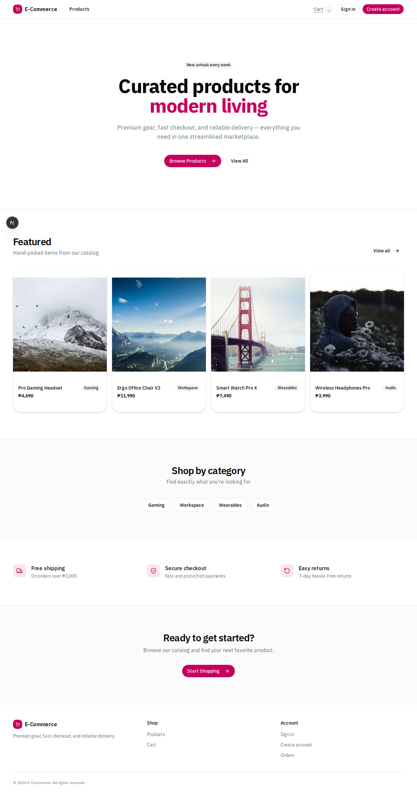

# E-Commerce



A full-stack e-commerce application built as a monorepo — product catalog, shopping cart, checkout, order management, and admin dashboard.

## Tech Stack

### Frontend (`apps/web`)
| Technology | Version |
|---|---|
| Next.js | 16.1.6 |
| React | 19.2.4 |
| TypeScript | 5.9.3 |
| Tailwind CSS | 4.1.18 |
| shadcn/ui | 4.2.0 |
| TanStack Query | 5.97.0 |
| Zustand | 5.0.12 |
| Recharts | 3.8.1 |
| BetterAuth | 1.6.2 |
| Sonner | 2.0.7 |

### Backend (`apps/api`)
| Technology | Version |
|---|---|
| NestJS | 11.1.6 |
| Prisma | 7.7.0 |
| PostgreSQL | — |
| Express | 5.2.1 |
| Stripe | 22.0.1 |
| BetterAuth | 1.6.2 |

### Tooling
| Tool | Version |
|---|---|
| pnpm | 12.15.0 |
| Turborepo | 2.8.17 |
| Biome | 1.9.4 |

## Features

**Storefront**
- Product catalog with search and category filtering
- Product detail pages with stock info and images
- Shopping cart with quantity management
- Checkout with shipping options and payment method selection (COD / mock card)
- Order history with status timeline

**Admin Dashboard**
- Revenue and order analytics with charts
- Order management with status updates
- Product CRUD (create, edit, feature, deactivate, delete)
- Stock management (inventory is reserved at checkout and restored on eligible cancellations; paid orders cannot be cancelled until a refund workflow exists)

**Auth**
- Email/password authentication via BetterAuth
- Session-based auth with middleware protection
- Admin password gate for admin routes

**UX**
- Responsive design (mobile + desktop)
- Loading skeletons, error boundaries, empty states
- Toast notifications on all user actions

## Project Structure

```
e-commerce/
├── apps/
│   ├── web/          # Next.js 16 frontend
│   └── api/          # NestJS 11 backend
├── packages/
│   └── ui/           # Shared shadcn/ui components
├── turbo.json        # Turborepo config
└── package.json      # Root workspace
```

## Environment Variables

Copy the template and fill in real values before running locally:

```bash
cp .env.example .env
```

Required keys:
- NEXT_PUBLIC_AUTH_BASE_URL (usually http://localhost:4000 in local dev)
- BETTER_AUTH_URL (API base URL for Better Auth)
- BETTER_AUTH_SECRET (long random secret)
- BETTER_AUTH_TRUSTED_ORIGINS (comma-separated allowed origins, e.g. http://localhost:3000)
- DATABASE_URL (PostgreSQL connection string in normal mode; set automatically in temporary SQLite mode)
- ADMIN_PASSWORD (32+ character admin panel password, web only)
- ADMIN_API_SECRET (separate 32+ character secret shared by API and web servers)
- PORT (API port; default 4000)

Email (password reset):
- RESEND_API_KEY — get a free key at https://resend.com. Omit only in local dev to log reset links; production password resets fail closed without it.
- RESEND_FROM_EMAIL — must be a verified sender in your Resend account (e.g. no-reply@yourdomain.com)

Payments:
- PAYMENT_PROVIDER=mock for local/demo (never treat mock payments as real money)
- PAYMENT_PROVIDER=stripe requires STRIPE_SECRET_KEY and STRIPE_WEBHOOK_SECRET. **Do not enable for live sales yet:** both the storefront and payment-intent API disable card checkout in Stripe mode until a Stripe Elements flow and payment/order reconciliation are implemented.

## Quick Start

```bash
# Install dependencies
pnpm install

# Set up environment
cp .env.example .env
cp .env.example apps/api/.env
cp .env.example apps/web/.env.local

# Set up database
pnpm --dir apps/api run db:migrate
pnpm --dir apps/api run db:generate
pnpm --dir apps/api run db:seed

# Run both apps
pnpm run dev:all
```

- Frontend: http://localhost:3000
- API: http://localhost:4000

### Temporary local SQLite (no PostgreSQL/Docker needed)

The schema and migrations are **PostgreSQL-only**. SQLite uses a derived local-only schema and `db push`; do not apply PostgreSQL migrations to it. SQLite tests do not replace PostgreSQL-specific concurrency/migration tests.

```bash
pnpm install
cp .env.example apps/api/.env
cp .env.example apps/web/.env.local
pnpm --dir apps/api run db:sqlite:setup
pnpm --dir apps/api run db:sqlite:seed
pnpm run dev:sqlite
```

The ignored database is `apps/api/dev.sqlite`. Run `pnpm --dir apps/api run test:e2e` for a disposable HTTP integration test (no PostgreSQL needed). SQLite setup regenerates the Prisma client, so stop the API before switching providers. To switch back to PostgreSQL, run `pnpm --dir apps/api run db:generate` (with a PostgreSQL `DATABASE_URL`), then `pnpm run dev:all`. The seed command is safe to repeat and does not overwrite existing products or orders.

## Key Routes

| Route | Description |
|---|---|
| `/products` | Product catalog |
| `/products/:slug` | Product detail |
| `/cart` | Shopping cart |
| `/checkout` | Checkout flow |
| `/orders` | Order history |
| `/orders/:id` | Order detail |
| `/account` | User account |
| `/admin` | Admin dashboard |
| `/admin/orders` | Order management |
| `/admin/products` | Product management |

## License

This project is licensed under the [MIT License](./LICENSE).
